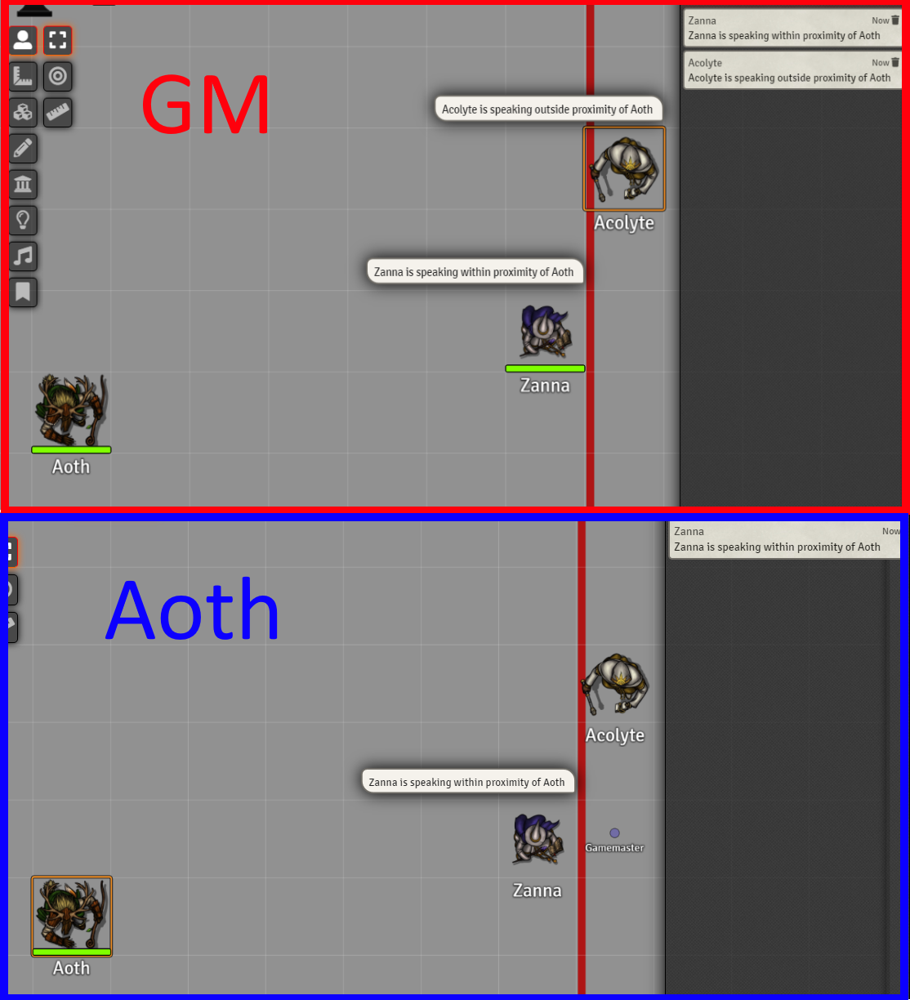

# Proximity Text Chat (Continued)

In the foundry, make sure that the message sent by your character is visible only to those nearby. Compatible with text-based campaigns.

This is a continuation work of [Proximity Text Chat](https://github.com/jessev14/proximity-text-chat) by **enso (jessev14)**, which has not been updated since Foundry v11. It's updated for Foundry VTT **v13 and v14** and extended with the some features. Licensed under GPL-3.0.



## Features

- **Voice tiers: whisper, talk and shout.** Each tier has its own hearing distance. Players switch tiers with the button in the chat input; the choice applies to their in-character messages until they change it. `/scream message` still works as a one-off shout.
- **Tier styling.** Whisper bubbles are small and faded, shout bubbles are big and bold. In the chat log, whispers and shouts get a coloured edge and a "whispers" / "shouts" tag.
- **Who hears my whisper.** With the whisper tier selected, the player characters within whisper range are listed next to the button.
- **Walls block speech** (optional). Whispers and talk are not heard through walls or closed doors. Windows and open doors let speech through. Shouts are only limited by distance.
- **Roll message distance** (optional). Attacks, damage, saves and item cards are visible within a set distance of where they happened, and hidden on other scenes.
- **Deafened and silenced** (optional). A deafened character does not hear in-character speech and gets a notice when someone nearby talks. A silenced character cannot speak in character; OOC and emotes still work.
- **Remembers what was heard.** Each browser stores whether the player heard a message when it arrived, so old conversations do not disappear or reappear after a refresh or when tokens move.
- **Chat bubbles.** Minimum bubble duration, separate shout duration, custom bubble font (Polyglot fonts are left alone) and text colour. Respects core "Pan to Token Speaker".
- **Emote styling** (optional). `/me` bubbles become floating italic text above the token.
- **Disguise and Wild Shape aware** (dnd5e). Messages from a transformed or disguised character still come from their token, and the player name is hidden while polymorphed.
- **`/telepathy UserName message`** sends a private message to that user (and the GMs).
- **Monk's TokenBar** saving throw and contested roll requests are only shown to the rollers and players in talk range.

GMs always see everything. Players always see their own messages, real whispers and OOC messages.

## Installation

Search for **Proximity Text Chat (Continued)** in Foundry (Add-on Modules → Install Module), or use this manifest URL:

```
https://github.com/mayflower-may/proximity-text-chat/releases/latest/download/module.json
```

Requires [libWrapper](https://foundryvtt.com/packages/lib-wrapper).

### Switching from the original module

This module has its own id (`proximity-text-chat-continued`), so it can be installed next to the original. Disable the original **Proximity Text Chat** in the world: while it is active, this module stays idle and warns the GM.

On the first start, the GM's browser copies the saved distances and bubble settings from the original module, and each player's selected voice tier is copied too. Old messages keep their whisper / shout tier.

## Settings

| Setting | Default |
|---|---|
| Whisper / Talk / Shout distance | 10 / 30 / 60 grid units |
| Require token visibility | off |
| Walls block speech | off |
| Roll message distance | 0 (off) |
| Deafened and silenced | on |
| Remember what was heard | on |
| Show who hears a whisper | on |
| Shout bubble duration | 3 s |
| Minimum bubble duration | 2 s |
| Bubble font | Signika |
| Bubble text colour | #000000 |
| Restyle emotes | on |

## Compatibility notes

- Chat bubbles: `ChatBubbles#say` is replaced (libWrapper `OVERRIDE`) to control bubble duration and font. Other modules that override `say` will conflict.
- Languages: English, Türkçe.

## Credits

- Original module: [enso (jessev14)](https://github.com/jessev14). Support the original author on [Ko-fi](https://ko-fi.com/jessev14).
- v13/v14 update and new features: [mayflower-may](https://github.com/mayflower-may).

## License

[GPL-3.0](LICENSE)
